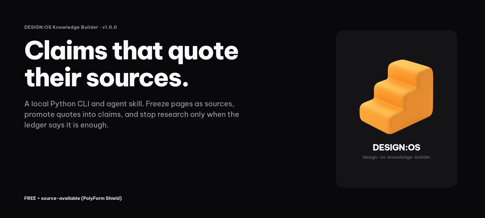
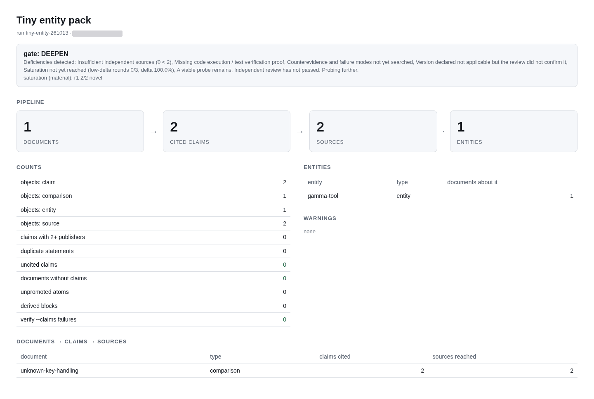
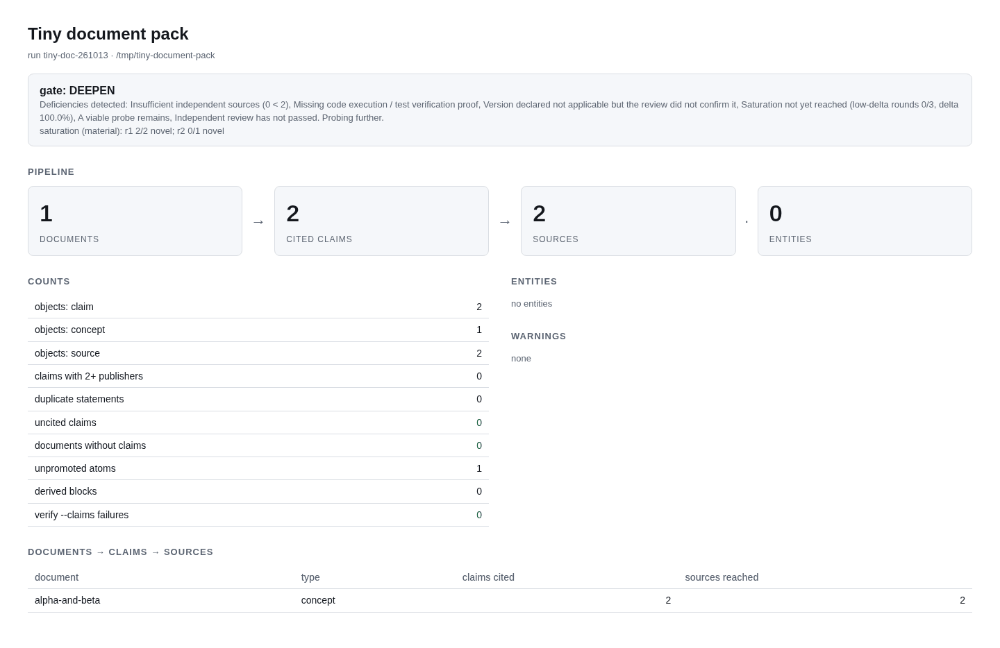
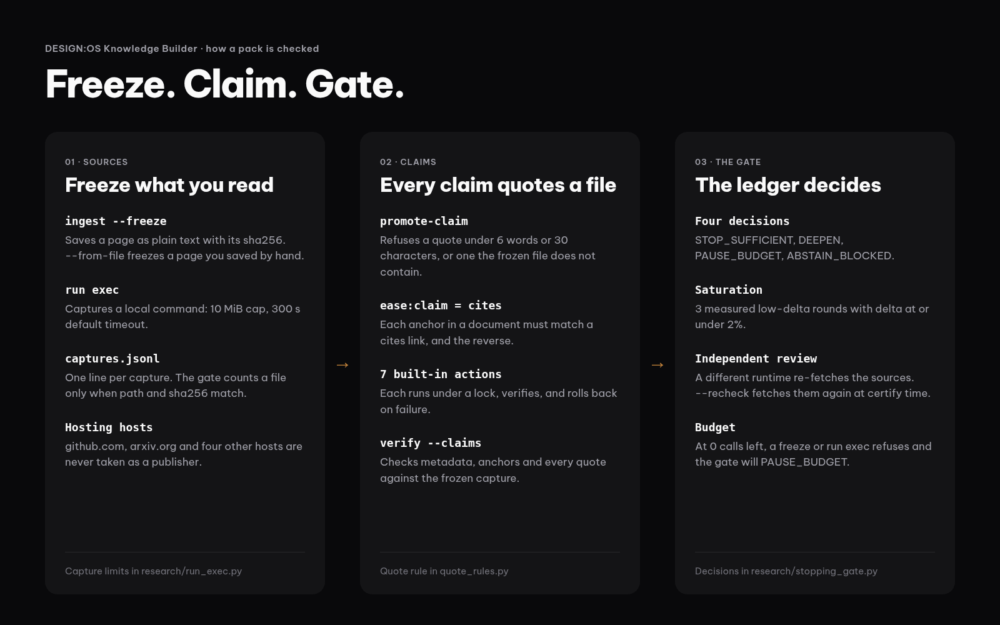

# DESIGN:OS Knowledge Builder

<p>
<picture>
  <source media="(prefers-color-scheme: dark)" srcset="docs/images/readme/cover-dark.png">
  <source media="(prefers-color-scheme: light)" srcset="docs/images/readme/cover-light.png">
  
</picture>
</p>

A local Python CLI and an agent skill for knowledge packs where every claim quotes a file you froze. You save web pages and command output as sources, promote quotes into claims, and `verify --claims` checks each quote against the frozen file. A stopping gate reads the research ledger and says when the evidence is enough. The skill (`skills/es-knowledge-forge/`) teaches Claude Code, Codex, Gemini CLI and Antigravity the same workflow.

Version 1.0.0, from `pyproject.toml`. Python 3.10 or later, and no third-party runtime dependencies (`dependencies = []`). The CLI is `knowledge-builder` (or `python3 -m knowledge_builder.cli`) with nine commands: `ingest`, `gate`, `lint`, `verify`, `index`, `run`, `query`, `action` and `pack`. The gate returns one of four decisions defined in `src/knowledge_builder/research/stopping_gate.py`: `STOP_SUFFICIENT`, `DEEPEN`, `PAUSE_BUDGET` or `ABSTAIN_BLOCKED`.

This repository stores no topic files. Packs live in a knowledge root you choose (`<knowledge-root>/<domain>/<topic>`), apart from the tool.

FREE + source-available ([PolyForm Shield 1.0.0](LICENSE)). It runs locally, with no telemetry. See [PRIVACY.md](PRIVACY.md).

<p>
  <a href="#quickstart">Quickstart</a> · <a href="#what-it-makes">What it makes</a> · <a href="#how-it-works">How it works</a> · <a href="#commands">Commands</a> · <a href="#install-for-your-agent">Install</a> · <a href="#limits">Limits</a>
</p>

## Quickstart

**In Claude Code:**

```text
/plugin marketplace add jangtrinh/design-os-knowledge-builder
/plugin install design-os-knowledge-builder@design-os-knowledge-builder
```

**From a clone:**

```bash
git clone https://github.com/jangtrinh/design-os-knowledge-builder.git
cd design-os-knowledge-builder
python3 -m venv .venv && . .venv/bin/activate
pip install -e .
knowledge-builder --help
python3 scripts/self_check.py
```

Without installing, run it from the checkout with `PYTHONPATH=src python3 -m knowledge_builder.cli --help`.

Then ask your agent in plain words:

> "Build an ontology-first knowledge pack on &lt;topic&gt;: freeze the sources, promote claims, cite them from a document, then run the stopping gate."

> "Check this knowledge pack: run `verify --claims` and `pack check`, and list the claims no document cites."

> "Add a claim to this pack from a verified evidence atom and cite it in the concept document."

More recipes are in [docs/cookbook.md](docs/cookbook.md).

## What it makes

A pack is plain files: `ontology.yaml`, `claims/`, `sources/`, documents, `index.json` and one `_evidence/<run>/` folder per research run. `look.py` renders a pack to one sheet so a person can check it at a glance. These two sheets are real `look.py` output for the example specs in `skills/es-knowledge-forge/examples/`, built with `build.py` and not edited.

<p>

</p>

<sub>design:os by Jang</sub>

<p>

</p>

<sub>design:os by Jang</sub>

Both gates say `DEEPEN`: a two-source example has too few independent sources and no review, so the gate keeps asking for more. That is the point.

| Output | What it is | Checked by |
| :--- | :--- | :--- |
| Ontology-first pack | Claims that quote frozen sources, cited from documents | `pack check` (`verify --claims` plus the stopping gate) |
| Index and object sets | `index.json` and `query` results, so an agent can query a pack instead of re-reading it | `query` refuses a stale index |
| Agent skill | `skills/es-knowledge-forge/`, which teaches an agent to build and check packs | `python3 scripts/self_check.py` |

## How it works

<p>
<picture>
  <source media="(prefers-color-scheme: dark)" srcset="docs/images/readme/flow-dark.png">
  <source media="(prefers-color-scheme: light)" srcset="docs/images/readme/flow-light.png">
  
</picture>
</p>

1. **Freeze.** `ingest --freeze` saves a page as plain text and prints its sha256. `run exec` captures a local command (10 MiB cap, 300 s default timeout). Each capture appends a line to `captures.jsonl`, and the gate counts a file only when its path and sha256 match that line.
2. **Claim.** `action promote-claim` turns a ledger atom into a claim. It refuses a quote under 6 words or 30 characters, or one the frozen file does not contain (`src/knowledge_builder/quote_rules.py`). A document cites a claim with an `ease:claim` anchor and a `cites` link, and the two must match.
3. **Gate.** `gate` reads the ledger. Saturation needs 3 measured low-delta rounds with delta at or under 2%. Independent review needs a reviewer other than the researcher. `--recheck` fetches the cited pages again at certify time.

The skill loads in layers so the agent's context stays small:

| File | Loaded when |
| :--- | :--- |
| `skills/es-knowledge-forge/SKILL.md` | Always. 120 lines; `tests/test_skill_shape.py` holds it to 120 or fewer |
| `rules.md`, `concepts.md`, `look.md` | While building, checking and reviewing a pack |
| `contract.txt` | When the agent needs exact CLI flags (generated, sha256 on its first line) |
| `references/` | Workflow, `UKMC.v2` summary and build spec, on demand |
| `commands/doctor.md`, `prompts/doctor.md` | Only for `/doctor` |

`build.py`, `validate.py` and `look.py` use the Python standard library only and call the `knowledge_builder` tool.

## Commands

The full list with every flag is `skills/es-knowledge-forge/contract.txt`, generated by `scripts/generate-skill-contract.py`. Below, `kb` stands for `knowledge-builder`.

| Command | What it does |
| :--- | :--- |
| `kb ingest <target>` | Ingest a PDF, video, image or URL. `--freeze` saves a page as a source |
| `kb verify [--claims] <root>` | Check metadata and anchors; `--claims` checks every quote against its frozen capture |
| `kb lint <file.md>` | Lint one markdown file against the UKMC standard |
| `kb index --root <root>` | Write `index.json` |
| `kb run init / record / status / measure / state set / exec / resolve / review` | The research ledger for one run |
| `kb gate --root <root> --run-id <run> [--recheck]` | The stopping decision |
| `kb pack init / status / check` | Scaffold, report on and check an ontology-first pack |
| `kb action <name>` | One typed, verified, logged write. Seven built in: `create-object`, `add-link`, `deprecate`, `promote-trust-tier`, `promote-claim`, `set-source`, `resolve-contradiction` |
| `kb query --root <root>` | Read-only filter over `index.json` |

Skill and repo checks:

```bash
python3 skills/es-knowledge-forge/build.py --spec skills/es-knowledge-forge/examples/tiny-entity-pack.json --output-dir /absolute/new-pack
python3 skills/es-knowledge-forge/validate.py --root /absolute/new-pack          # exit 0 ok, 1 reject, 2 could not run
python3 skills/es-knowledge-forge/look.py --root /absolute/new-pack --sheet /absolute/look-sheet.png   # needs Chrome or Chromium
python3 scripts/generate-skill-contract.py --check                                # the skill's CLI contract is current
python3 scripts/self_check.py                                                     # manifests, governance files, skill present
PYTHONPATH=src python3 -m unittest discover -s tests -t . -q                      # or python3 -m pytest -q inside .venv
```

<details>
<summary>The full ledger, gate and ontology reference</summary>

#### Research ledger: `run` and `ingest --freeze`
```bash
# One run = _evidence/<id>/{state.json,evidence.jsonl,sources/,captures.jsonl}
kb run init --root <knowledge-root> --id <run> --budget 400 --require <claim-id> --researcher <runtime>

# Freeze a web page as plain text into sources/ (identity encoding, gzip decoded, never overwrites).
# This fetches that URL. Prints the sha256 and the path to cite.
kb ingest --freeze <url> --root <knowledge-root> --run <run> --stem <kebab-case-stem>
# When a site returns HTTP 401/403/429, save the page and freeze the file. --from-file does not fetch.
kb ingest --freeze <url> --from-file <saved.html> --root <knowledge-root> --run <run> --stem <kebab-case-stem>
# Capture a local command (stdout and stderr, cap 10 MiB, timeout default 300s). Does not fetch. Never overwrites.
# A failing command is still captured: kb exits 0 and the file records the command's exit code.
kb run exec --root <knowledge-root> --id <run> --stem <kebab-case-stem> [--timeout 300] -- <argv...>

# Each successful freeze (either mode) and each run exec spends one budget call, under the ledger lock.
# At 0 remaining both refuse before fetching or running:
#   budget exhausted (used N of N): the gate will PAUSE_BUDGET

# The command that wrote the file appends one JSON line to captures.jsonl:
# path, sha256, origin (fetched | from-file | executed), url, command, exit_code, captured_at, tool_version.
# The gate counts a source only when a line has the same path and sha256.
# When any cited file lacks that line it prints: unattested sources: N: path1, path2
# verify --claims fails an unattested ontology capture and names the path. There is no backfill.

# Append one atom from stdin. metadata.round is an integer >= 1; metadata.novel is a boolean.
kb run record --root <knowledge-root> --id <run> < atom.json

# Per-round novelty: an atom is novel when its quote, after newline normalisation, did not
# occur on any atom of an earlier round (backfill atoms count as earlier quotes).
# metadata.novel is ignored for the count. delta(r) = novel atoms in r / atoms before r.
# Round 1 is the baseline. A round with fewer than 5 non-backfill atoms is printed as
# "(too small: N < 5, not counted)" and neither extends nor resets the low-delta streak.
# --material counts a novel atom only when an ease:source or ease:claim anchor cites its quote.
# Run --material --write-state after citing each round's claims; if no novel atom in a counted
# round is cited yet, state.json is left untouched.
# Atoms with metadata.backfill=true are excluded from the numerator and the denominator
# (printed as "backfill atoms: N (excluded)"). Nothing is written unless --write-state is given.
kb run measure --root <knowledge-root> --id <run> --material [--write-state]

# Re-fetch every logged fetched or from-file capture and check each atom quote on the live page.
# Writes _evidence/<run>/review.json. Does not write sources and does not spend a budget call.
# Refuses an empty reviewer or one equal to state.json researcher_runtime.
# Exit 0 when the file is written. The verdict is data, not the exit code.
# A page that cannot be fetched is recorded as unreachable.
kb run review --root <knowledge-root> --id <run> --reviewer <runtime> --verdict pass|fail \
  [--note "<text>"] [--confirm-version-na] [--confirm-execution-na]

# A quote verifies only when it has at least 6 words and 30 characters, after newline
# normalisation, and occurs in the capture body (text after the first blank line when the
# file starts with Source-URL:, Fetched:, or Command:; the whole file otherwise).
# Too short: quote must be at least 6 words and 30 characters

# Typed writes to state.json. Settable keys: round, has_viable_probe_remaining,
# is_target_version_matched, version_applicability (applicable | not_applicable),
# version_reason, execution_applicability (applicable | not_applicable),
# execution_reason.
# consecutive_low_delta_rounds and last_weighted_delta are measured: only
# `run measure --write-state` writes them. `resolved` is not settable.
kb run state set --root <knowledge-root> --id <run> --key version_applicability --value not_applicable
kb run state set --root <knowledge-root> --id <run> --key version_reason --value "concept pack: no target library"
kb run state set --root <knowledge-root> --id <run> --key execution_applicability --value not_applicable
kb run state set --root <knowledge-root> --id <run> --key execution_reason --value "concept pack: no executable code"

# Resolve one CONTRADICTION atom. Appends {"atom", "reason"} to state.json resolutions.
# The atom must exist and be a CONTRADICTION; the reason must be non-empty.
kb run resolve --root <knowledge-root> --id <run> --atom <contradiction-atom-id> --reason "<text>"

# The gate reads the ledger. It prints "low-delta rounds N/3" and, for declared
# not-applicable checks, "Version:  not applicable: <reason>" / "Execution: not applicable: <reason>".
# A legacy string list in state.json "resolved" does not resolve an atom. When that list
# is non-empty the gate prints: ignored legacy resolved entries: N
# Offline, quote checks use the sources list in review.json. --recheck fetches each
# attested fetched or from-file capture an atom cites and uses those findings instead.
# It prints: recheck: N sources fetched, M unreachable, K quotes missing
# When an executed capture backs execution proof it also prints:
# recheck: execution captures are not re-run
# An unreachable source fails closed the same way as a missing quote.
# A STOP_SUFFICIENT decision without --recheck also prints:
# note: sources were checked by the review, not now; rerun with --recheck to fetch them
kb gate --root <knowledge-root> --run-id <run> [--recheck]
```
`version_applicability: not_applicable` and `execution_applicability: not_applicable` pass their respective gate checks only with a non-empty reason and a current review whose `confirm_version_na` or `confirm_execution_na` is true. Without the reason the gate says the reason is missing. With a reason the review did not confirm, it says the review did not confirm it.

A source file counts for verified claims, independent sources, execution proof and counterevidence only when `captures.jsonl` matches its path and sha256. A fetched capture counts toward independent sources when it is attested. A from-file capture counts only when the current review found its quotes. An executed capture never counts. A quote that is too short, or that appears only in the capture header, does not verify. Execution proof counts only for an atom whose capture origin is `executed`, whose exit code is 0, and whose `metadata.command` equals the logged command; `metadata.command` on any other atom is ignored. A `FAILURE_MODE` atom counts only when it is attested and its quote verifies. A contradiction is resolved for the gate by a `resolutions` entry with that atom id and a non-empty reason, or by `resolve-contradiction` / deprecating one side.

The gate treats `review.json` as a review only when it names the reviewer, a pass or fail verdict, a note, the time, the three hashes (ledger, capture log, claim files), both confirm flags, and a sources list. `independent_review_passed` is true only when the verdict is pass, the reviewer differs from the researcher, those hashes still match the files, and every required claim's verifying atom was found on re-fetch (or its capture origin is `executed`). A hand-written file without those fields is no review. When the bound file is stale the reason names the file that changed. When a quote is missing it names the atom and the quote. Offline, that re-fetch is the sources list stored in `review.json`. `gate --recheck` and `pack check --recheck` replace that list with a fetch done at certify time. The hashes, verdict, reviewer and confirm flags are still required.

Every file under the knowledge root is local and writable by whoever runs the research. Offline, the gate trusts the findings stored in `review.json`. `--recheck` makes whoever certifies fetch the pages themselves, so a forged review no longer suffices. Execution captures are still trusted from the log.

#### Ontology packs: `pack`, `action`, `query`
A root with an `ontology.yaml` is in ontology mode (`UKMC.v2`); without one the tool behaves as before and prints a legacy-mode warning to stderr. See the `UKMC.v2` section of [docs/master-contract-ukmc.md](docs/master-contract-ukmc.md).
```bash
kb pack init --root <pack-root> --topic "my topic" --run my-run --require some-claim-id   # new or empty root only
kb pack status --root <pack-root>        # one screen of counts (add --json)
kb pack check --root <pack-root> [--recheck]   # exits 0 only when verify --claims passes; prints the gate decision. --recheck fetches first
kb query --root <pack-root> --object-type concept --status active --fields id,links_in_count   # read-only; refuses a stale index
kb action promote-claim --root <pack-root> --param atom=hb-1 --param kind=official
kb action promote-claim --root <pack-root> --param atom=hb-3 --param into=<claim-id> --param kind=academic
kb action promote-claim --root <pack-root> --batch atoms.jsonl     # all or nothing, one verify for the batch
kb action promote-claim --root <pack-root> --param atom=sa-1 --param kind=first-party   # local execution output: no URL, publisher local, never independent
kb action set-source --root <pack-root> --param source=<source-id> --param publisher=Microsoft   # re-attribute a Source: publisher and/or kind
kb action create-object --root <pack-root> --param id=<id> --param object_type=entity --param title="..."
kb action add-link --root <pack-root> --param source=<id> --param link_type=cites --param target=<claim-id>
kb action add-link --root <pack-root> --batch links.jsonl          # many links, one verify, all or nothing
kb action resolve-contradiction --root <pack-root> --param claim=<id> --param resolution="<text>"
```
Default actions: `create-object`, `add-link`, `deprecate`, `promote-trust-tier`, `promote-claim`, `set-source`, `resolve-contradiction`. Actions declared in `ontology.yaml` `action_types` are merged with the defaults; declaring the same name overrides a default. Every action runs under one lock per root, edits atomically, verifies, rolls back on failure, rebuilds the index and appends a line to `_actions/actions.jsonl`; a refused action appends one line to `_actions/rejected.jsonl` instead (`pack status` shows the count).

Rules the tool enforces:
- `set-source` edits only the `publisher` and/or `kind` lines of a `frozen-source` object (kind must be in the type's declared enum; a hosting or mirror host is refused as publisher; a refusal goes to `rejected.jsonl`). Publisher counts, `pack status` `with_2_publishers` and the gate's independence follow at once; publishers compare case-insensitively.
- `promote-claim` refuses an atom whose frozen file hash or quote does not verify, and an atom that is already promoted (the error names the claim). A quote must be at least 6 words and 30 characters and occur in the capture body (`quote must be at least 6 words and 30 characters`). Pass `--param id=<short-kebab-id>` to name the claim; without it the id is the first words of the statement, cut at 60 characters.
- It does not guess a publisher from a hosting or mirror host (`web.archive.org`, `github.com`, `raw.githubusercontent.com`, `githubusercontent.com`, `arxiv.org`, `hackmd.io`, and subdomains): pass `--param publisher=<who published it>`. `pack status` and `pack check` print a `warning:` for a publisher whose sources carry more than one `kind`.
- Promoting a `CONTRADICTION` atom also promotes the atom named in `metadata.contradicts` and links the two with `contradicts`. That records the contradiction; it resolves nothing for the stopping gate. `resolve-contradiction` (or deprecating one side) does, and the claim must still verify. `run resolve` appends a reason for that atom to `state.json` `resolutions`.
- `create-object` takes the parameters of the object type it creates: `id`, `object_type`, `title`, every property the type declares (enum, integer and boolean values are checked before anything is written; an undeclared name is refused and the declared ones are listed), and, for a type with an interface, `domain`, `description`, `when` and `source`. The file goes into the type's `folder:`.
- `promote-trust-tier` to `verified` also needs the stopping gate to return STOP_SUFFICIENT for every `_evidence/<run>` the file cites.

#### Anchor rule: `ease:claim` must equal `cites`
A document cites a claim with `<!-- ease:claim id=<claim-id> -->` under the block it supports and a `cites` link to that claim. The quote lives only in the claim. Every anchor id must be in the document's `cites` links and every `cites` target must be used by an anchor; `verify --claims` rejects either mismatch.

Other anchor rules checked by `verify --claims`:
- A quote that contains `"` is written with single quotes: `<!-- ease:source uri=... sha256=... quote='He said "go".' -->`. A quote holding both `"` and `'` cannot be written either way; cite a shorter fragment.
- A `Derived:`, `Observed:`, or `Decision:` line directly above a table or code fence (the very next line) exempts that one block. A blank line in between, or the label below the block, does not.

</details>

## Install for your agent

Every option installs the same skill, `skills/es-knowledge-forge/SKILL.md`.

**Claude Code:** the two `/plugin` commands in Quickstart.

**Codex**

```bash
git clone https://github.com/jangtrinh/design-os-knowledge-builder.git /tmp/design-os-knowledge-builder
mkdir -p ~/.codex/skills/es-knowledge-forge ~/.codex/prompts
cp -R /tmp/design-os-knowledge-builder/skills/es-knowledge-forge/* ~/.codex/skills/es-knowledge-forge/
cp /tmp/design-os-knowledge-builder/prompts/doctor.md ~/.codex/prompts/es-knowledge-forge-doctor.md
rm -rf /tmp/design-os-knowledge-builder
```

**Gemini CLI and Antigravity**

```bash
git clone https://github.com/jangtrinh/design-os-knowledge-builder.git /tmp/design-os-knowledge-builder
mkdir -p ~/.gemini/skills/es-knowledge-forge
cp -R /tmp/design-os-knowledge-builder/skills/es-knowledge-forge/* ~/.gemini/skills/es-knowledge-forge/
rm -rf /tmp/design-os-knowledge-builder
```

**OpenCode, Cursor, Windsurf and other harnesses**

```bash
git clone https://github.com/jangtrinh/design-os-knowledge-builder.git /tmp/design-os-knowledge-builder
mkdir -p ~/.agents/skills/es-knowledge-forge
cp -R /tmp/design-os-knowledge-builder/skills/es-knowledge-forge/* ~/.agents/skills/es-knowledge-forge/
rm -rf /tmp/design-os-knowledge-builder
```

The skill scripts call the `knowledge_builder` tool, so keep a checkout next to the skill, pass `--repo-root <checkout>`, or run `pip install -e .` from the checkout. A copied skill is a snapshot: copy it again after you update the repository. Run `/doctor` in Claude Code or Codex to see installed skill paths, plugin manifests and gate health.

To uninstall:

```bash
rm -rf ~/.claude/skills/es-knowledge-forge ~/.codex/skills/es-knowledge-forge ~/.gemini/skills/es-knowledge-forge ~/.agents/skills/es-knowledge-forge
```

CI (`.github/workflows/test.yml`) runs the full test suite on Python 3.10 and 3.12, then `generate-skill-contract.py --check` and `self_check.py`. A healthy checkout prints `ok: design-os-knowledge-builder self-check passed (es-knowledge-forge)`.

## Limits

Network use is narrow. `ingest --freeze` without `--from-file` fetches that URL. `run review` re-fetches the URLs of logged captures. `gate --recheck` and `pack check --recheck` fetch those pages again at certify time. `--from-file`, `run exec`, `validate.py` and `look.py` do not fetch, and without `--recheck` neither do `gate` nor `pack check`.

Every file under the knowledge root is local and writable by whoever runs the research. Offline, the gate trusts the findings stored in `review.json`. `--recheck` makes whoever certifies fetch the pages themselves, so a forged review no longer passes. Execution captures are still trusted from the log.

It is the wrong tool for freeform brainstorming, for storing credentials or personal customer data, and as a replacement for a transactional or vector database.

## DESIGN:OS

Knowledge Builder is one of the DESIGN:OS tools. The others: [Studio](https://github.com/jangtrinh/design-os-studio), [CLI](https://github.com/jangtrinh/design-os), [Bridge](https://github.com/jangtrinh/design-os-figma-plugin), [SVG Animation](https://github.com/jangtrinh/design-os-svg-animation), [3D Blender](https://github.com/jangtrinh/design-os-3d-blender) and [mcp-bridge-go](https://github.com/jangtrinh/mcp-bridge-go). More on [jangtrinh.github.io](https://jangtrinh.github.io/).

Docs: [jangtrinh.github.io/design-os-knowledge-builder](https://jangtrinh.github.io/design-os-knowledge-builder/) · Pack contract: [docs/master-contract-ukmc.md](docs/master-contract-ukmc.md) · Changelog: [CHANGELOG.md](CHANGELOG.md) · Index for AI agents: [llms.txt](llms.txt)

## Contributing and license

- [CONTRIBUTING.md](CONTRIBUTING.md) · [CODE_OF_CONDUCT.md](CODE_OF_CONDUCT.md) · [SECURITY.md](SECURITY.md) · [PRIVACY.md](PRIVACY.md)
- [PolyForm Shield 1.0.0](LICENSE). FREE to use and modify, including for paid client work; you may not resell it or build a competing product from it.

If `design-os-knowledge-builder` saves you time, a star on GitHub helps other engineers and AI agents find it.

<p align="left">
  <a href="https://buymeacoffee.com/jangtrinh">
    
  </a>
</p>

Built by [Jang Trịnh](https://github.com/jangtrinh), creative technologist and autonomous system architect.

[GitHub](https://github.com/jangtrinh) · [LinkedIn](https://www.linkedin.com/in/jangtrinh/) · [Hub](https://jangtrinh.github.io/) · [YouTube](https://www.youtube.com/@designosbyjang) · [X](https://x.com/Jangtrinhvn)
