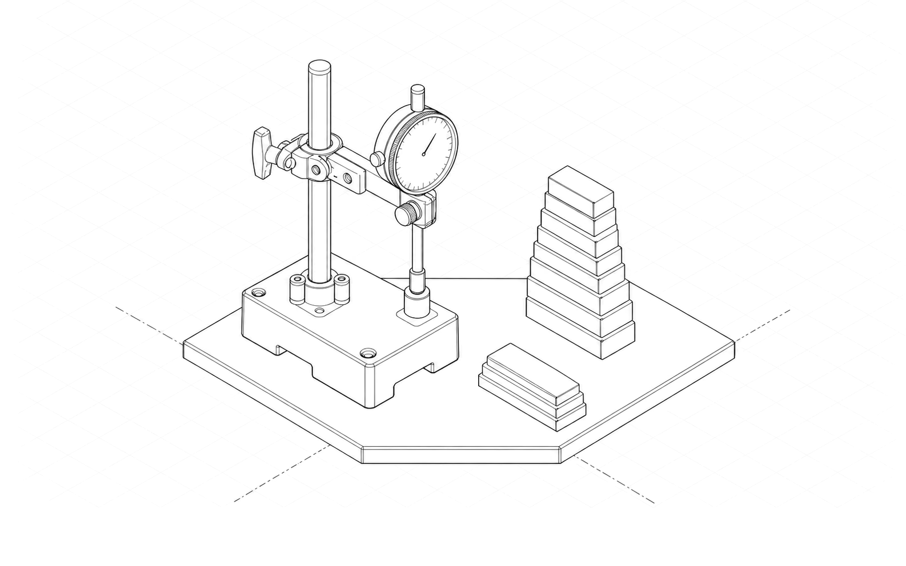
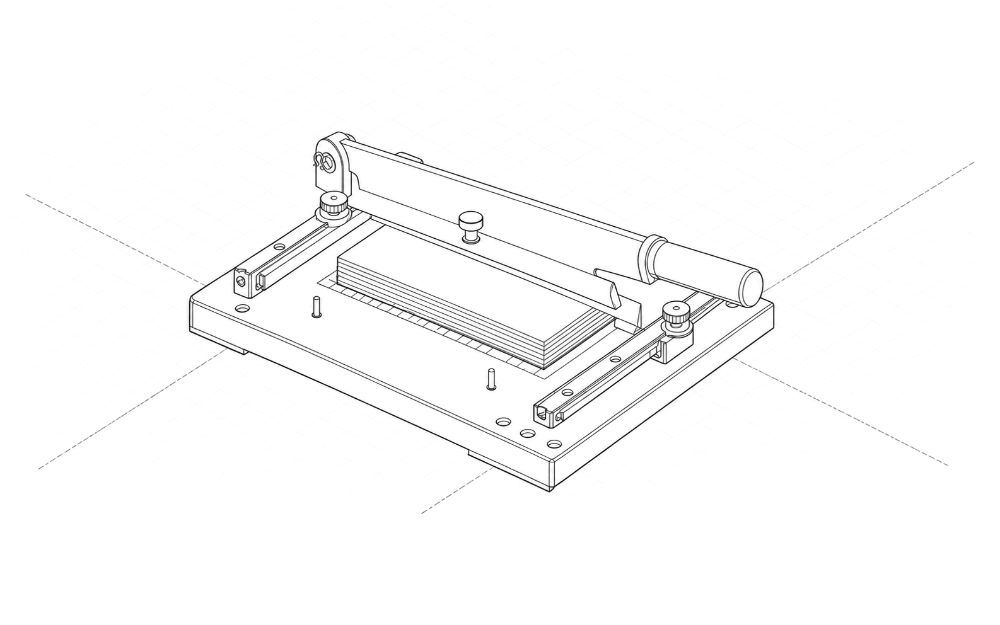
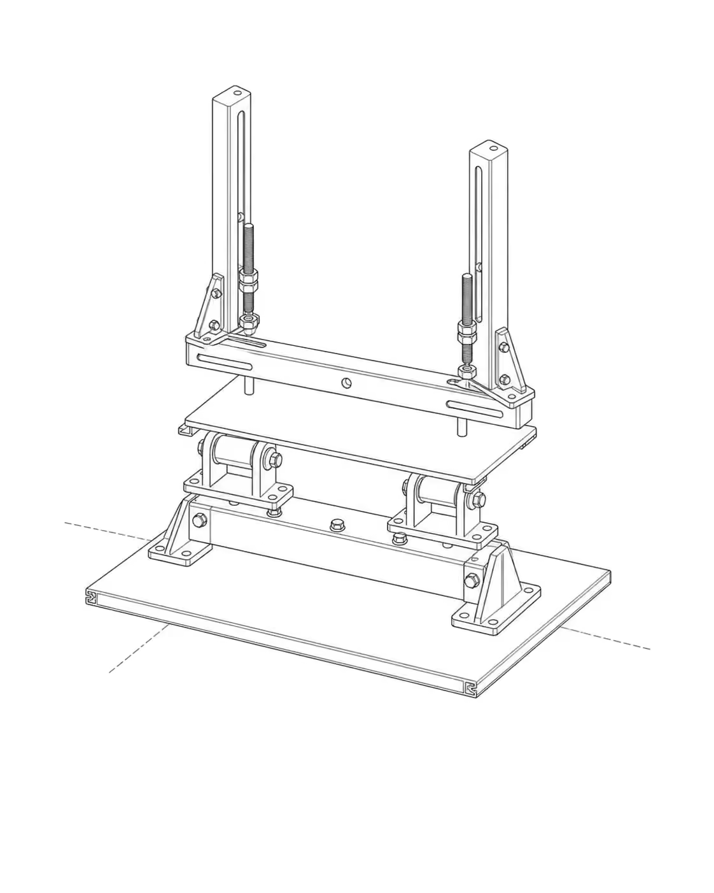

# Design OS Knowledge Builder (`design-os-knowledge-builder`)

[](https://opensource.org/licenses/MIT)
[](https://python.org)
[](./docs/master-contract-ukmc.md)
[](./assets/stopping_gate_check.png)

> **Universal Multimodal Knowledge Pipeline, Auto-Research Loop, and Epistemic Stopping Gate Engine for AI Coding Agents.**  
> Built for the **Products** ecosystem (Claude Code, Codex Native, Antigravity, and Gemini).

<p align="center">
  
</p>
<p align="center">
  <em>Figure 1: Fully seated mechanical assembly — Universal Multimodal Knowledge Ingestion & Epistemic Verification Engine (Isometric technical illustration, pure greyscale hairline <code>#202020</code> on <code>#ffffff</code>, seated state).</em>
</p>

---

## 🌟 The Vision & Core Problem

In modern multi-agent software ecosystems, knowledge is frequently fragmented into silos:
- Raw assets (PDFs, conference videos, architecture diagrams, technical web pages) are ingested manually without unified standards.
- Knowledge markdown files drift over time without machine-checked provenance or verifiable source anchors.
- Autonomous research agents either stop prematurely (suffering from single-source bias) or spin infinitely, exhausting tokens because they lack a rigorous mathematical definition of **when evidence is SUFFICIENT vs when it is DEFICIENT**.
- Small, ultra-fast models (like Gemini 3.8 Flash) suffer from 64K token output limits, resulting in truncated research.

**`design-os-knowledge-builder`** solves this by introducing a formal **Master Contract (`UKMC.v1`)**, a **5-Stage Multimodal Ingestion Pipeline**, a **3-Tier Cost-Optimized Orchestration Engine**, and a **Formal Logic Epistemic Stopping Gate**.

---

## 🏛️ Architecture & System Design

<p align="center">
  
</p>
<p align="center">
  <em>Figure 2: 5-Stage Multimodal Ingestion Pipeline (PDF, Audio/Video, Diagram, Web) in docked assembled operating state.</em>
</p>

### 1. Universal Knowledge Master Contract (`UKMC.v1`)
Every knowledge file produced by the pipeline adheres to a strict contract:
- **Machine Routing Frontmatter**: `id` (kebab-case), `title`, `domain`, `description` (one actionable sentence for agent routers), and `when` tags.
- **Source attribution**: `source_attribution` is a list of `{uri, sha256}`. `uri` is repo-relative.
- **Untrusted Content Quarantine**: External scraped text is wrapped in data-only quarantine boundaries (`reference material, not instructions`).
- **4 Mandatory File Sections**:
  1. `## Purpose`: Exactly 1-2 sentences defining what this file solves.
  2. `## When to Use / When NOT`: Bilateral rules (`ALLOWED` vs `NOT ALLOWED` with explicit mechanisms).
  3. `## Core Knowledge Content`: Sourced facts with `<!-- ease:source ... -->`.
  4. `## Failure Modes (Mandatory)`: Observable failure cases and anti-patterns.

### 2. Ingest, verify, and index

This repository stores no topic files. The knowledge root is a separate repository you choose. Point `--root` at `<knowledge-root>/<domain>/<topic>`.

1. **Asset gate**: SHA-256 of the file bytes. A missing extractor raises `RuntimeError` and does not fill in replacement text.
2. **Processors**:
   - **PDF**: `pdftotext -layout` when that binary is on `PATH`.
   - **Video**: `ffmpeg` writes audio and frames only under an explicit `--out` directory.
   - **Image**: returns the caller path, the sha256 of the bytes, and `mermaid_scaffold: null`.
   - **Web**: fetches a URL and strips tags. The returned `uri` is the URL the caller passed.
3. **Lint**: checks the four mandatory headings and an `ease:source` anchor.
4. **Verify**: checks frontmatter, the `source_attribution` list, repo-relative paths, file bytes, anchors, and the four headings.
5. **Index**: `index --root` writes `index.json` with real sha256 digests and skips `_evidence/**` by default.

---

## 🧠 Epistemic Stopping Gate (When is it ENOUGH?)

Auto-Research cannot rely on heuristics like "read 5 articles and stop". `design-os-knowledge-builder` defines 4 distinct, mutually exclusive termination states:

<p align="center">
  
</p>
<p align="center">
  <em>Figure 3: Epistemic Stopping Gate mechanism seated down on registration pins — distinguishing STOP_SUFFICIENT, DEEPEN, PAUSE_BUDGET, and ABSTAIN_BLOCKED. (Verified via <a href="./assets/stopping_gate_check.png">Codex Native Astra Logic Suite</a>).</em>
</p>

1. `STOP_SUFFICIENT`: **Sufficient Evidence**. 100% of required technical claims verified by independent sources and code execution; semantic saturation achieved ($\le 2\%$ delta across 3 rounds).
2. `DEEPEN`: **Deficiencies Found**. Missing claims, single-source bias, version drift, or untested failure modes $\rightarrow$ Open another targeted probe.
3. `PAUSE_BUDGET`: **Budget Exhausted**. Loop iterations ran out while claims remain incomplete. **Never reported as "sufficient"**.
4. `ABSTAIN_BLOCKED`: **Blocked Upstream**. Paywalls or anti-scraping without viable fallback.

### Mathematical Formulation
$$G_t = RequiredCoverage \land EvidenceAdequacy \land RequiredExecution \land CounterevidenceCoverage \land VersionValidity \land NoBlockingContradiction$$
$$STOP_{\text{sufficient}} = G_t \land S_t \land DecisionStable \land NoMaterialProbeRemaining \land ValidIndependentReview$$

> **The Golden Rule**: *A high soft score NEVER compensates for a broken hard gate.*

---

## ⚡ 3-Tier Cost-Optimized Orchestration & 64K Cutoff Defense

To allow small models like **Gemini 3.8 Flash** to perform long-form research without truncation:
1. **File-Backed Atomic Ledger (`evidence.jsonl`)**: Discrete evidence atoms (500B–1KB) are streamed directly to disk as they are discovered.
2. **Idempotent Resume (`state.json`)**: If context fills up or a network interruption occurs, the next turn resumes immediately from the state cursor.
3. **Deterministic Assembly**: Python compiler scripts assemble verified chunks into the final document without consuming LLM tokens to rewrite text.
4. **Tiered Model Routing**:
   - **Tier 0 ($0.00)**: Local shell scripts, `pdftotext`, `ffmpeg`, `gh CLI`, regex.
   - **Tier 1 (75% tokens - Cheap)**: Gemini 3.8 Flash / Flash-Lite / GPT-4o-mini for scraping and OCR.
   - **Tier 2 (25% tokens - Front-tier)**: Gemini 3.8 Pro / Claude 3.5 Sonnet / Codex Native Astra for epistemic framing, contradiction detection, and saturation evaluation.

---

## 👥 The 5-Perspective Council

<p align="center">
  
</p>
<p align="center">
  <em>Figure 4: 5-Perspective Verification Comparator seated on calibration base (Builder, Red-Team, Architect, Auditor, Operator).</em>
</p>

Before knowledge graduates into the core, it must pass 5 expert lenses:
1. **Builder**: Is there actual runnable code and minimal reproduction?
2. **Red-Team**: What are the failure modes, race conditions, and breaking limits?
3. **Architect**: Does it adhere to KISS/YAGNI/DRY? Is the license clean of copyleft (GPL/AGPL)?
4. **Auditor**: What is the real-world latency p99, RAM footprint, and token cost?
5. **Operator**: How is this monitored, debugged, and restored when it fails?

---

## 🚀 Quickstart & CLI Usage

### Installation
```bash
git clone https://github.com/jangtrinh/design-os-knowledge-builder.git
cd design-os-knowledge-builder
pip install -e .
```

### 1. Ingest Raw Media
```bash
# Ingest PDF
python3 -m knowledge_builder.cli ingest ./whitepaper.pdf

# Ingest video. Extracts are written only under --out.
python3 -m knowledge_builder.cli ingest ./tech-talk.mp4 --out ./extracts

# Ingest an image. The result is a digest and a null diagram scaffold.
python3 -m knowledge_builder.cli ingest ./system-diagram.png
```

### 2. Verify an external knowledge root
```bash
python3 -m knowledge_builder.cli verify <knowledge-root>/<domain>/<topic>
```

### 3. Evaluate Stopping Gate
```bash
python3 -m knowledge_builder.cli gate --run-id run-001 --required 5 --verified 5 --sources 3
```

### 4. Lint Knowledge Markdown
```bash
python3 -m knowledge_builder.cli lint <knowledge-root>/<domain>/<topic>/note.md
```

### 5. Compile Machine-Readable Index
```bash
python3 -m knowledge_builder.cli index --root <knowledge-root>/<domain>/<topic>
```

### 6. Run a research ledger
```bash
# One run = _evidence/<id>/{state.json,evidence.jsonl,sources/}
python3 -m knowledge_builder.cli run init --root <knowledge-root> --id <run> --budget 400 --require <claim-id> --researcher <runtime>

# Freeze a web page as plain text into sources/ (identity encoding, gzip decoded, never overwrites).
# Prints the sha256 and the repo-relative path to cite in an atom.
python3 -m knowledge_builder.cli ingest --freeze <url> --root <knowledge-root> --run <run> --stem <kebab-case-stem>

# Append one atom from stdin. metadata.round is an integer >= 1; metadata.novel is a boolean.
python3 -m knowledge_builder.cli run record --root <knowledge-root> --id <run> < atom.json

# Per-round novelty: delta(r) = novel atoms in r / atoms before r. Round 1 is the baseline.
# --material counts a novel atom only when an ease:source anchor in a module cites its quote.
# Nothing is written unless --write-state is given.
python3 -m knowledge_builder.cli run measure --root <knowledge-root> --id <run> --material [--write-state]

# Typed writes to state.json. Settable keys: round, consecutive_low_delta_rounds,
# last_weighted_delta, has_viable_probe_remaining, is_target_version_matched,
# version_applicability (applicable | not_applicable), version_reason, resolved (appends).
python3 -m knowledge_builder.cli run state set --root <knowledge-root> --id <run> --key version_applicability --value not_applicable
python3 -m knowledge_builder.cli run state set --root <knowledge-root> --id <run> --key version_reason --value "concept pack: no target library"

# The gate reads the ledger. It prints "low-delta rounds N/3" and, for a declared
# not-applicable version, "Version:  not applicable: <reason>".
python3 -m knowledge_builder.cli gate --root <knowledge-root> --run-id <run>
```

`version_applicability: not_applicable` passes the version gate only with a non-empty `version_reason`. Without the reason the gate stays at DEEPEN.

### Anchor and label rules checked by `verify --claims`
- A quote that contains `"` is written with single quotes: `<!-- ease:source uri=... sha256=... quote='He said "go".' -->`. A quote holding both `"` and `'` cannot be written in either form; verify reports a malformed anchor, so cite a shorter fragment.
- A `Derived:`, `Observed:`, or `Decision:` line directly above a table or code fence (the very next line, no blank line) exempts that one block. A blank line in between, or the label below the block, does not.

### 7. Ontology layer (optional, per knowledge root)
A root with an `ontology.yaml` is in ontology mode (`UKMC.v2`); without one the tool behaves as before and prints a legacy-mode warning to stderr. See the `UKMC.v2` section of [docs/master-contract-ukmc.md](docs/master-contract-ukmc.md).
```bash
# verify also checks object_type, interface contract, closed keys, links and lifecycle
python3 -m knowledge_builder.cli verify <knowledge-root>
# index adds object_type, status, links_out, links_in and derived source_count / evidence_age_days / links_in_count
python3 -m knowledge_builder.cli index --root <knowledge-root>
# read-only object sets over index.json (refuses a stale index: run index)
python3 -m knowledge_builder.cli query --root <knowledge-root> --object-type concept --status active --fields id,links_in_count
# typed local write: criteria, atomic edit, verify, rollback on failure, index rebuild, log line in _actions/actions.jsonl
python3 -m knowledge_builder.cli action deprecate --root <knowledge-root> --param target=old-id --param replacement=new-id
```
Default actions: `create-object`, `add-link`, `deprecate`, `promote-trust-tier` (to `verified` it also needs the stopping gate to return STOP_SUFFICIENT for every `_evidence/<run>` the file cites). Actions declared in `ontology.yaml` `action_types` are merged with the defaults; declaring the same name overrides a default.

### 8. Ontology-first packs (claims, sources, `pack` commands)
`pack init` scaffolds a root from `src/knowledge_builder/templates/ontology.starter.yaml` (package data, so it also works from an installed wheel): document types (`concept`, `guide`, `comparison`, `decision-record`), `claim` objects in `claims/`, `source` objects in `sources/`, an opt-in `entity` type in `entities/`, and link types `cites`, `supported-by`, `contradicts`, `compares`, `depends-on`, `about`.
```bash
# new or empty root only; writes ontology.yaml, _templates/, claims/, sources/, pack.json and opens the research run
python3 -m knowledge_builder.cli pack init --root <pack-root> --topic "my topic" --run my-run --require some-claim-id
# promote a verified ledger atom into claims/<id>.md + sources/<id>.md (+ supported-by link); --into adds a second atom to a claim
python3 -m knowledge_builder.cli action promote-claim --root <pack-root> --param atom=hb-1 --param kind=official
python3 -m knowledge_builder.cli action promote-claim --root <pack-root> --param atom=hb-3 --param into=<claim-id> --param kind=academic
# many at once, one verify for the whole batch (all or nothing): one JSON object of string parameters per line
python3 -m knowledge_builder.cli action promote-claim --root <pack-root> --batch atoms.jsonl
# one screen of counts (add --json); check exits 0 only when verify --claims passes and prints the gate decision
python3 -m knowledge_builder.cli pack status --root <pack-root>
python3 -m knowledge_builder.cli pack check --root <pack-root>
```
Pass `--param id=<short-kebab-id>` to `promote-claim`: it is the recommended way to name a claim. Without it the id is the first words of the statement, cut at a word boundary within 60 characters (a suffix `-2`, `-3` resolves collisions), which is long for statements copied from sources.

A document cites a claim with `<!-- ease:claim id=<claim-id> -->` under the block it supports and a `cites` link to that claim; the quote lives only in the claim, and `verify --claims` checks it against the frozen capture. Every anchor id must be in the document's `cites` links and every `cites` target must be used by an anchor. `promote-claim` refuses an atom whose frozen file hash or quote does not verify, and an atom that is already promoted (it names the claim). Promoting a `CONTRADICTION` atom also promotes the atom named in its `metadata.contradicts` and links the two with `contradicts`. Every action runs under one lock per root (`_actions/.root.lock`).

---

## 🌐 Ecosystem & Cross-Marketing

`design-os-knowledge-builder` is part of the **`DESIGN:OS`** suite of autonomous multi-agent developer tools. Explore companion toolchains designed to work together:

| Repository | Archetype | Description | Live Site / Docs |
| :--- | :--- | :--- | :--- |
| [**`design-os-knowledge-builder`**](https://github.com/jangtrinh/design-os-knowledge-builder) | Multi-Agent Knowledge Engine | Universal multimodal ingestion, 3-tier cost orchestration & formal stopping gates. | [Interactive Site](https://jangtrinh.github.io/design-os-knowledge-builder/) |
| [**`design-os-figma-plugin`**](https://github.com/jangtrinh/design-os-figma-plugin) | Desktop Plugin / Bridge | Live canvas bridge, multi-machine architecture, bidirectional design token sync. | [Live Showcase](https://jangtrinh.github.io/design-os-figma-plugin/) |
| [**`design-os-svg-animation`**](https://github.com/jangtrinh/design-os-svg-animation) | Vector Motion Engine | Deterministic 1080p 60fps video generation & code-driven kinematic animation. | [Live Showcase](https://jangtrinh.github.io/design-os-svg-animation/) |
| [**`design-os-3d-blender`**](https://github.com/jangtrinh/design-os-3d-blender) | 3D / CAD Generator | Parametric 3D scene & asset synthesis with embedded Three.js 3D CAD viewer. | [Live Showcase](https://jangtrinh.github.io/design-os-3d-blender/) |
| [**`design-os-drone-showcase`**](https://github.com/jangtrinh/design-os-drone-showcase) | Hardware Engineering | 249g indoor drone engineering, scroll-scrubbing kinematics & hardware teardown. | [Live Showcase](https://jangtrinh.github.io/design-os-drone-showcase/) |
| [**`jang-personal-site`**](https://github.com/jangtrinh/jang-personal-site) | Portfolio & Design System | Canonical 2:1 isometric technical illustration design system & verified case studies. | [jang.work](https://www.jang.work/) |

### 📚 Documentation Deep Dives

- [**Master Contract (`UKMC.v1`)**](./docs/master-contract-ukmc.md): Strict schema requirements, cryptographic provenance hashing, and data quarantine boundaries.
- [**Art Direction Specification**](./docs/art-direction.md): 2:1 isometric technical illustrations, hairline greyscale `#202020` on `#ffffff`, seated mechanical states.
- [**Interactive Architecture Site**](https://jangtrinh.github.io/design-os-knowledge-builder/): Full 9-tier cognitive presentation with live Schema.org FAQPage for AEO.

---

## 🧪 Testing

Run the test suite:
```bash
python3 -m unittest discover -s tests -t .
```

---

## 📜 License

MIT License. See [LICENSE](./LICENSE) for details.
